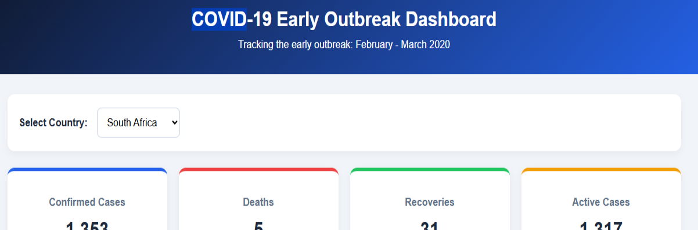
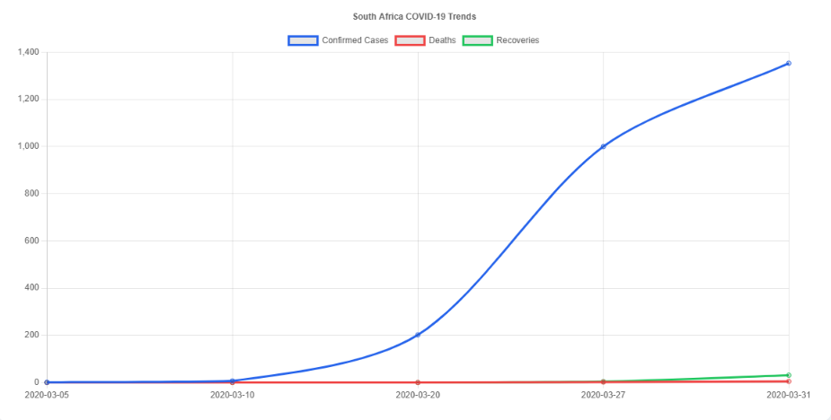
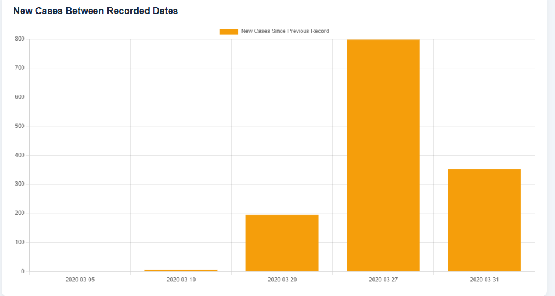

# COVID-19 Early Outbreak Dashboard

## Project Description
An interactive dashboard that displays COVID-19 statistics from February to March 2020 for countries included in the dataset.

## Features
- Country selection dropdown
- Confirmed cases, deaths, recoveries, and active cases
- Line chart showing COVID-19 trends over time
- Bar chart showing new cases between recorded dates

## Technologies Used
- HTML
- CSS
- JavaScript
- JSON
- Chart.js

## How to Run
1. Open the project folder in VS Code.
2. Run `python -m http.server 8000` in the terminal.
3. Open `http://127.0.0.1:8000` in your browser.
4. Select a country to view its statistics.

## Screenshots

